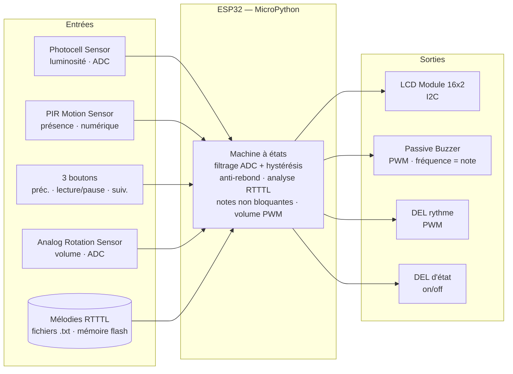
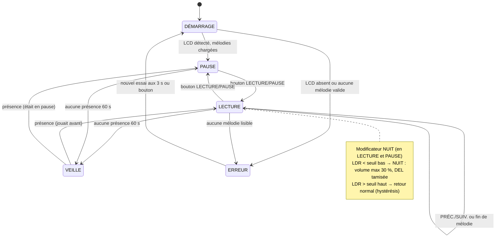

# Livrable 1 — Choix de projet et plan de projet

**Projet : RadioSense — lecteur de musique intelligent**
420-314 — Épreuve finale — Automne 2026 · Cégep Marie-Victorin
Équipe : Madhav Ramdin, Jade Mendoza · Enseignant : Maxime

> Tous les composants viennent de la liste des composants disponibles du cours
> (`Composants_disponibles.xlsx`), sauf l'ESP32 DevKit V1.

## 1. Problème et fonction du prototype

On laisse souvent la musique jouer dans une pièce vide, et le volume reste trop fort le soir.
RadioSense est un petit lecteur de musique autonome, pour une chambre ou un bureau, qui s'adapte à son environnement.
Il joue des mélodies enregistrées dans la mémoire flash de l'ESP32 (fichiers texte au format RTTTL) sur un buzzer passif.
Un écran LCD affiche le titre, l'état, le numéro de piste et le volume. Trois boutons et un potentiomètre servent à le contrôler.
Quand personne n'est présent pendant 60 s (capteur PIR), il se met en pause et en veille, puis reprend dès qu'une présence est détectée.
Dans une pièce sombre (photorésistance), il passe en mode NUIT : le volume est plafonné et la DEL est tamisée.

## 2. Diagramme fonctionnel

## 3. Diagramme d'états

| État | Description | LCD | DEL d'état |
|---|---|---|---|
| DÉMARRAGE | Vérifie le LCD et charge la liste des mélodies | « Chargement… » | éteinte |
| LECTURE | La mélodie joue sur le buzzer (DEL rythme active) | titre, n° de piste, volume, ▶ | éteinte |
| PAUSE | La mélodie est arrêtée temporairement | titre, n° de piste, volume, ❚❚ | éteinte |
| VEILLE | Aucune présence pendant 60 s (reprise au retour) | éteint (rétroéclairage coupé) | clignote (1 Hz) |
| ERREUR | LCD non détecté ou aucune mélodie valide | « Aucune mélodie » (si le LCD répond) | allumée fixe |

## 4. Correspondance avec les exigences

| Exigence | Solution choisie |
|---|---|
| Plateforme | ESP32 DevKit V1 (WROOM-32) en MicroPython (remplacement approuvé) |
| Capteur analogique | Photocell Sensor (luminosité) et Analog Rotation Sensor (volume), sur l'ADC1 |
| Capteur numérique | PIR Motion Sensor (présence) |
| Sortie PWM | Buzzer passif (fréquence = note, rapport cyclique = volume) et DEL rythme (luminosité selon le volume de la note) |
| Sortie numérique | DEL d'état (erreur, veille) |
| Composant nouveau | LCD I2C (PCF8574), buzzer passif piloté en fréquence, mélodies RTTTL en mémoire flash |
| Interaction locale | 3 boutons + potentiomètre en façade |
| 2 formes de rétroaction | Visuelle (LCD, DEL) et sonore (buzzer passif) |
| Au moins 2 modes | 5 états (DÉMARRAGE, LECTURE, PAUSE, VEILLE, ERREUR) + mode NUIT |
| Réaction intelligente | Pause/veille automatique sans présence, reprise automatique, mode NUIT selon la lumière |
| Traitement des données | Moyenne des lectures ADC, hystérésis, anti-rebond, conversion des notes RTTTL en fréquences et durées |
| Gestion d'erreurs | LCD absent ou aucune mélodie valide → ERREUR, message LCD, DEL fixe, nouvel essai ; fichier invalide sauté |
| Code non bloquant | `ticks_ms()`/`ticks_diff()` pour l'enchaînement des notes, la veille et le clignotement (aucun `sleep`) |
| Fonctionnement autonome | Démarrage automatique par `main.py`, aucun ordinateur requis |

## 5. Liste préliminaire des composants

Le nom en premier est celui de la liste des composants disponibles.

| Composant | Qté | Rôle | Tension | Protocole |
|---|---|---|---|---|
| ESP32 DevKit V1 (WROOM-32), hors liste | 1 | Traitement | 5 V USB (logique 3,3 V) | — |
| LCD Module (LCD 16x2 + PCF8574) | 1 | Affichage | 5 V | I2C (adresse 0x27) |
| Passive Buzzer | 1 | Jouer les mélodies | 3,3 V (GPIO) | PWM |
| push button 2 pin | 3 | Préc. / lecture-pause / suiv. | 3,3 V | Numérique |
| Analog Rotation Sensor (potentiomètre) | 1 | Volume | 3,3 V | Analogique |
| Photocell Sensor (LDR) | 1 | Luminosité | 3,3 V | Analogique |
| PIR Motion Sensor | 1 | Présence | 5 V (sortie 3,3 V) | Numérique |
| White LED Module | 2 | DEL rythme / DEL d'état | 3,3 V (GPIO) | PWM / numérique |
| Power Bank | 1 | Alimentation autonome | 5 V | USB |
| Kit breadboard, fils, boîtier | — | Montage, maquette | — | — |

## 6. Attribution préliminaire des broches

| GPIO | Composant | Type | Remarque |
|---|---|---|---|
| 21 | LCD Module SDA | I2C | Bus I2C par défaut |
| 22 | LCD Module SCL | I2C | Bus I2C par défaut |
| 25 | Passive Buzzer | PWM | Fréquence = note, rapport cyclique = volume |
| 32 | Bouton PRÉCÉDENT | Entrée numérique | Pull-up interne, actif à LOW |
| 33 | Bouton LECTURE/PAUSE | Entrée numérique | Pull-up interne, actif à LOW |
| 13 | Bouton SUIVANT | Entrée numérique | Pull-up interne, actif à LOW |
| 34 | Analog Rotation Sensor | ADC1 (11 dB) | Entrée seulement, pas de pull-up interne |
| 35 | Photocell Sensor | ADC1 (11 dB) | Entrée seulement, pas de pull-up interne |
| 14 | PIR Motion Sensor | Entrée numérique | Sortie ≈ 3,3 V (à vérifier au multimètre) |
| 17 | DEL rythme (White LED Module) | PWM | Résistance déjà sur le module |
| 16 | DEL d'état (White LED Module) | Sortie numérique | Libre sur WROOM, pas sur WROVER |

Vérification : aucun conflit. Seul l'ADC1 est utilisé (l'ADC2 serait inutilisable avec le Wi-Fi), GPIO34–35 servent uniquement d'entrées, et les broches de démarrage (GPIO0, 2, 5, 12 et 15) restent libres.

## 7. Alimentation

- **5 V (broche VIN, venant de l'USB ou de la Power Bank)** : LCD Module, PIR Motion Sensor.
- **3,3 V (régulateur de l'ESP32)** : Analog Rotation Sensor, Photocell Sensor. Le buzzer et les DEL sont commandés directement par leur GPIO.
- **Précautions**
  - Jamais plus de 3,3 V sur une entrée de l'ESP32 : le potentiomètre et la photorésistance sont alimentés en 3,3 V, jamais en 5 V.
  - LCD en 5 V : retirer les résistances de rappel du PCF8574 (sinon SDA et SCL sont à 5 V), ou ajouter un convertisseur de niveau.
  - Vérifier le brochage (S, +, −) de chaque module et sa tension au multimètre avant de le brancher.
  - Certaines batteries externes se coupent si la consommation est trop faible : la tester tôt, sinon utiliser un chargeur USB 5 V.
  - Masse commune à tous les modules.

## 8. Répartition initiale du travail

| Madhav Ramdin | Jade Mendoza |
|---|---|
| Montage : buzzer passif, DEL rythme et DEL d'état | Montage : LCD I2C, 3 boutons, potentiomètre |
| Code : lecture des mélodies RTTTL, liste de pistes, préc./suiv. | Code : machine à états et anti-rebond des boutons |
| Code : enchaînement non bloquant des notes, volume PWM, DEL rythme | Code : affichage LCD (titre, piste, volume, état) |
| Code : DEL d'état, gestion de l'état ERREUR | Montage + code : PIR (veille) et photorésistance (mode NUIT, hystérésis) |
| Maquette : câblage interne du boîtier | Maquette : façade (LCD, boutons, potentiomètre) |

**Ensemble :** tests d'intégration, documentation, préparation de l'oral.

## 9. Échéancier

| Date | Étape |
|---|---|
| Semaine du 23 nov. | Livrable 1, emprunt du matériel (liste des composants disponibles) |
| Semaine du 30 nov. | **Livrable 2** : chaque module testé seul (LCD, buzzer, boutons, capteurs) |
| Semaine du 7 déc. | **Livrable 3** : intégration complète, machine à états, maquette |
| 10 déc. | **Remise finale** (code, documentation, maquette) |
| Semaine du 14 déc. | **Examen oral** |

## 10. Risques et solutions

| Risque | Solution |
|---|---|
| Pas d'ampli audio ni de lecteur microSD dans la liste | Mélodies RTTTL jouées sur le buzzer passif, stockées dans la mémoire flash de l'ESP32 |
| Son limité du buzzer (une note à la fois, volume peu linéaire) | Volume par rapport cyclique PWM avec une courbe de correction ; mélodies choisies dans la plage où le buzzer sonne bien |
| Bruit de l'ADC (volume qui saute, NUIT qui clignote) | Moyenne de plusieurs lectures + hystérésis |
| Fichier de mélodie invalide ou absent | Fichier vérifié à l'analyse et sauté ; aucune mélodie valide → état ERREUR, message LCD, DEL fixe |
| 5 V sur le bus I2C (LCD) | Retirer les résistances de rappel du module ou ajouter un convertisseur de niveau |
| Brochage et tension différents selon les modules (S, +, −) | Lire la sérigraphie et vérifier au multimètre (Digital Multimeter de la liste) avant de brancher |
| PIR instable (chauffe d'environ 60 s, faux déclenchements) | Délai du PIR au minimum (si le module le permet), attente de stabilisation au démarrage, temporisation de 60 s dans le code |
| Power Bank qui se coupe (consommation trop faible) | La tester dès le Livrable 2 ; sinon chargeur USB 5 V |
| Quantités limitées (ex. Analog Rotation Sensor : 22, White LED Module : 23) | Réserver le matériel dès la semaine du 23 nov. |
