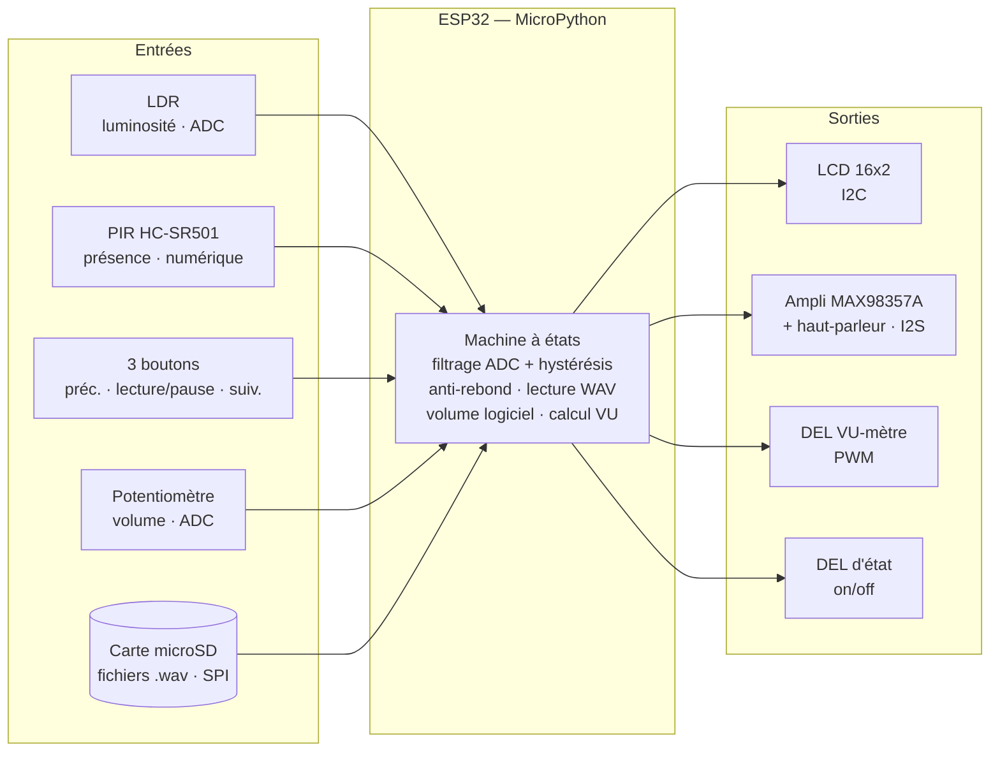
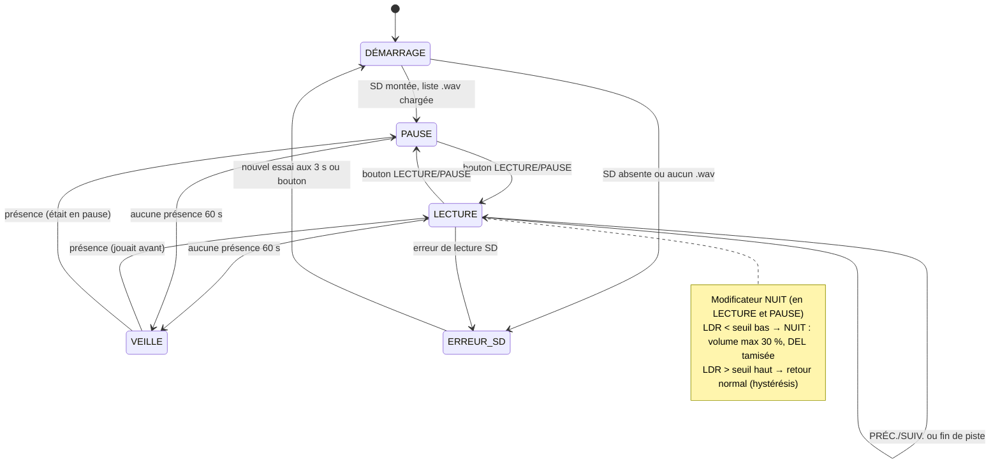

# Livrable 1 — Choix de projet et plan de projet

**Projet : RadioSense — lecteur de musique intelligent**
420-314 — Épreuve finale — Automne 2026 · Cégep Marie-Victorin
Équipe : Madhav Ramdin, Jade Mendoza · Enseignant : Maxime

## 1. Problème et fonction du prototype

On laisse souvent la musique jouer dans une pièce vide, et le volume reste trop fort le soir.
RadioSense est un petit lecteur de musique autonome, pour une chambre ou un bureau, qui s'adapte à son environnement.
Il lit des fichiers .wav sur une carte microSD et les joue sur un haut-parleur.
Un écran LCD affiche le titre, l'état, le numéro de piste et le volume. Trois boutons et un potentiomètre servent à le contrôler.
Quand personne n'est présent pendant 60 s (capteur PIR), il se met en pause et en veille, puis reprend dès qu'une présence est détectée.
Dans une pièce sombre (LDR), il passe en mode NUIT : le volume est plafonné et la DEL est tamisée.

## 2. Diagramme fonctionnel

## 3. Diagramme d'états

| État | LCD | DEL d'état |
|---|---|---|
| DÉMARRAGE | « Chargement… » | éteinte |
| LECTURE / PAUSE | titre, n° de piste, volume, ▶/❚❚ | éteinte |
| VEILLE | éteint (rétroéclairage coupé) | clignote (1 Hz) |
| ERREUR_SD | « Erreur carte SD » | allumée fixe |

## 4. Correspondance avec les exigences

| Exigence | Solution choisie |
|---|---|
| Plateforme | ESP32 DevKit V1 (WROOM-32) en MicroPython (remplacement approuvé) |
| Capteur analogique | LDR (luminosité) et potentiomètre (volume), sur l'ADC1 |
| Capteur numérique | PIR HC-SR501 (présence) |
| Sortie PWM | DEL VU-mètre : sa luminosité suit l'amplitude du son |
| Sortie numérique | DEL d'état (erreur SD, veille) |
| Composant nouveau | LCD I2C, lecteur microSD (SPI), audio I2S (MAX98357A) |
| Interaction locale | 3 boutons + potentiomètre en façade |
| 2 formes de rétroaction | Visuelle (LCD, DEL) et sonore (haut-parleur) |
| Au moins 2 modes | 5 états (DÉMARRAGE, LECTURE, PAUSE, VEILLE, ERREUR_SD) + mode NUIT |
| Réaction intelligente | Pause/veille automatique sans présence, reprise automatique, mode NUIT selon la lumière |
| Traitement des données | Moyenne des lectures ADC, hystérésis, anti-rebond, calcul d'amplitude pour le VU |
| Gestion d'erreurs | SD absente ou illisible → ERREUR_SD, message LCD, DEL fixe, nouvel essai |
| Code non bloquant | `ticks_ms()`/`ticks_diff()`, I2S en mode non bloquant (interruption) |
| Fonctionnement autonome | Démarrage automatique par `main.py`, aucun ordinateur requis |

## 5. Liste préliminaire des composants

| Composant | Qté | Rôle | Tension | Protocole |
|---|---|---|---|---|
| ESP32 DevKit V1 (WROOM-32) | 1 | Traitement | 5 V USB (logique 3,3 V) | — |
| LCD 16x2 + module PCF8574 | 1 | Affichage | 5 V | I2C (adresse 0x27) |
| Module microSD + carte (FAT32) | 1 | Stockage des .wav | 3,3 V | SPI |
| Ampli MAX98357A | 1 | Amplification audio | 5 V | I2S |
| Haut-parleur 4 Ω, 3 W | 1 | Son | — (sortie ampli) | — |
| Bouton-poussoir | 3 | Préc. / lecture-pause / suiv. | 3,3 V | Numérique |
| Potentiomètre 10 kΩ linéaire | 1 | Volume | 3,3 V | Analogique |
| LDR + résistance 10 kΩ | 1 + 1 | Luminosité | 3,3 V | Analogique |
| PIR HC-SR501 | 1 | Présence | 5 V (sortie 3,3 V) | Numérique |
| DEL + résistance 220 Ω | 2 | VU-mètre / état | 3,3 V | PWM / numérique |
| Condensateur 470 µF | 1 | Stabiliser le 5 V de l'ampli | 5 V | — |
| Bloc USB 5 V 2 A, breadboard, fils, boîtier radio | — | Alimentation, montage, maquette | 5 V | — |

## 6. Attribution préliminaire des broches

| GPIO | Composant | Type | Remarque |
|---|---|---|---|
| 21 | LCD SDA | I2C | Bus I2C par défaut |
| 22 | LCD SCL | I2C | Bus I2C par défaut |
| 18 | microSD SCK | SPI | Bus VSPI |
| 19 | microSD MISO | SPI | Bus VSPI |
| 23 | microSD MOSI | SPI | Bus VSPI |
| 5 | microSD CS | SPI | Broche de démarrage : doit rester haute au boot (pull-up du module) |
| 26 | MAX98357A BCLK | I2S | — |
| 25 | MAX98357A LRC | I2S | — |
| 27 | MAX98357A DIN | I2S | — |
| 32 | Bouton PRÉCÉDENT | Entrée numérique | Pull-up interne, actif à LOW |
| 33 | Bouton LECTURE/PAUSE | Entrée numérique | Pull-up interne, actif à LOW |
| 13 | Bouton SUIVANT | Entrée numérique | Pull-up interne, actif à LOW |
| 34 | Potentiomètre | ADC1 (11 dB) | Entrée seulement, pas de pull-up interne |
| 35 | LDR (diviseur) | ADC1 (11 dB) | Entrée seulement, pas de pull-up interne |
| 14 | PIR | Entrée numérique | PWM au boot sans effet (entrée) |
| 17 | DEL VU-mètre | PWM | 220 Ω en série |
| 16 | DEL d'état | Sortie numérique | 220 Ω en série (libre sur WROOM, pas sur WROVER) |

Vérification : aucun conflit. Seul l'ADC1 est utilisé (l'ADC2 serait inutilisable avec le Wi-Fi), GPIO34–35 servent uniquement d'entrées, et GPIO0, 2, 12 et 15 restent libres.

## 7. Alimentation

- **5 V (broche VIN, venant de l'USB)** : LCD, ampli MAX98357A, PIR.
- **3,3 V (régulateur de l'ESP32)** : module microSD, potentiomètre, diviseur LDR.
- **Précautions**
  - Jamais plus de 3,3 V sur une entrée de l'ESP32. Le potentiomètre et la LDR sont donc alimentés en 3,3 V, jamais en 5 V.
  - LCD en 5 V : retirer les résistances de rappel du PCF8574 (sinon SDA et SCL sont à 5 V), ou ajouter un convertisseur de niveau.
  - La sortie du PIR est à 3,3 V, donc compatible avec l'ESP32.
  - Le haut-parleur 4 Ω peut tirer environ 0,7 A en crête : bloc USB de 2 A et condensateur de 470 µF près de l'ampli, pour éviter un redémarrage de l'ESP32 par chute de tension.
  - Masse commune à tous les modules.

## 8. Répartition initiale du travail

| Madhav Ramdin | Jade Mendoza |
|---|---|
| Montage : microSD (SPI) et ampli I2S + haut-parleur | Montage : LCD I2C, 3 boutons, potentiomètre |
| Code : lecture des WAV, liste de pistes, préc./suiv. | Code : machine à états et anti-rebond des boutons |
| Code : volume logiciel, VU-mètre PWM | Code : affichage LCD (titre, piste, volume, état) |
| Montage + code : DEL d'état, gestion ERREUR_SD | Montage + code : PIR (veille) et LDR (mode NUIT, hystérésis) |
| Maquette : câblage interne du boîtier | Maquette : façade (LCD, boutons, potentiomètre) |

**Ensemble :** tests d'intégration, documentation, préparation de l'oral.

## 9. Échéancier

| Date | Étape |
|---|---|
| Semaine du 23 nov. | Livrable 1, commande et vérification du matériel |
| Semaine du 30 nov. | **Livrable 2** : chaque module testé seul (SD, I2S, LCD, capteurs) |
| Semaine du 7 déc. | **Livrable 3** : intégration complète, machine à états, maquette |
| 10 déc. | **Remise finale** (code, documentation, maquette) |
| Semaine du 14 déc. | **Examen oral** |

## 10. Risques et solutions

| Risque | Solution |
|---|---|
| Pas de décodage MP3 en MicroPython | Fichiers WAV PCM 16 bits mono, 16–22 kHz |
| Coupures du son (lecture SD trop lente, RAM limitée) | Petit tampon réutilisé, I2S non bloquant, WAV mono à basse fréquence |
| Bruit de l'ADC (volume qui saute, NUIT qui clignote) | Moyenne de plusieurs lectures + hystérésis |
| Carte SD absente ou illisible | État ERREUR_SD : message LCD, DEL fixe, nouvel essai automatique |
| 5 V sur le bus I2C (LCD) | Retirer les résistances de rappel du module ou ajouter un convertisseur de niveau |
| Redémarrage de l'ESP32 au volume fort | Bloc 2 A, condensateur 470 µF, volume maximal limité |
| PIR instable (chauffe d'environ 60 s, faux déclenchements) | Délai du HC-SR501 au minimum, attente de stabilisation au démarrage, temporisation de 60 s dans le code |
